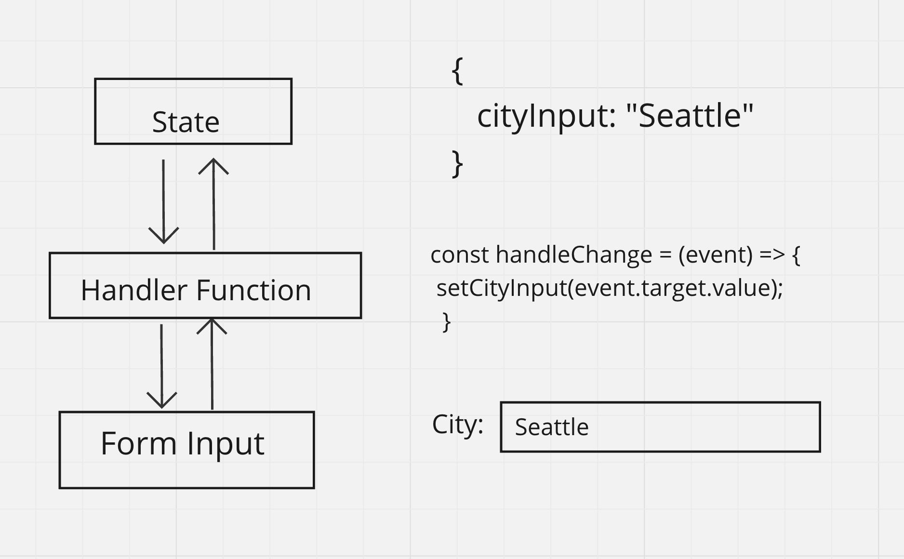
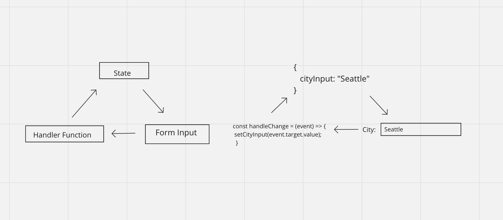

# 

**Learning objective:** By the end of this lesson, students will be able to explain the concept of React’s virtual DOM and its importance with controlled forms in React applications.

## React's virtual DOM

In web browsers, the DOM is like a map of a website's layout, where each part of the HTML structure is represented as nodes and objects. The virtual DOM, specific to React, is a lightweight, memory-based copy of the actual DOM, essentially a duplicate object managed by React.

Traditional DOM manipulation requires manual state management through the use of event handlers, variables and direct content updates. This is often complex and prone to sync issues between the app's state and its display. React's virtual DOM simplifies state management and maintains consistency between the application's data and its visual representation.

Through a process called reconciliation, React updates the actual DOM to match the desired state as defined in the virtual DOM, enabling a more streamlined and declarative approach to UI development.

### A Helpful Analogy

Imagine that the UI of our React app is a giant skyscraper. The real DOM is the building and represents the elements and structure displayed on the screen. Any changes we make to the building would be time-consuming and cumbersome. In fact, we'd need to tear down and rebuild the skyscraper whenever we wanted to make any changes to the building. Sounds expensive.

React's virtual DOM is like a real-time holographic model of our skyscraper. Since it's just a holograph, we can easily manipulate and update. In fact, we can make frequent changes to our holograph without changing the actual building itself. When changes _do_ need to be made to our building, the virtual DOM allows React to make only the necessary updates efficiently. Rather than tearing down and rebuilding, our skyscraper is compared against the holographic's new "ideal" model. It is only updated where React noticed any differences.

## Accessing real time input in forms

In a regular HTML setup, when someone types into a form field, the browser keeps track of what’s typed internally, in its own memory. But this information isn't directly shared with our React component.

This leads to two main problems:

- **Our app can't respond to changes**: For example, if our React component needs to show a message or check the input as the user types, it can't do that effectively. The most recent input value isn't stored in a place where the React component can access it.

- **Information flow is limited**: The data goes only one way – from the user typing to the browser storing it. Our React component isn't in the loop.

To fix this, we use what are called [**controlled inputs**](https://react.dev/reference/react-dom/components/input#controlling-an-input-with-a-state-variable). This technique lets our React component take control over the form inputs, ensuring it stays updated and can react to every change made by the user.

### Controlling inputs in React

In controlled inputs, the React component's state is directly tied to the value of the input field, ensuring the input displays what's in the state. This means there is a handler function firing an event each time a user types a character, which updates state, which updates the input filed. Its a complex cycle giving React total control of each input field as a user is interacting with it.

OR

