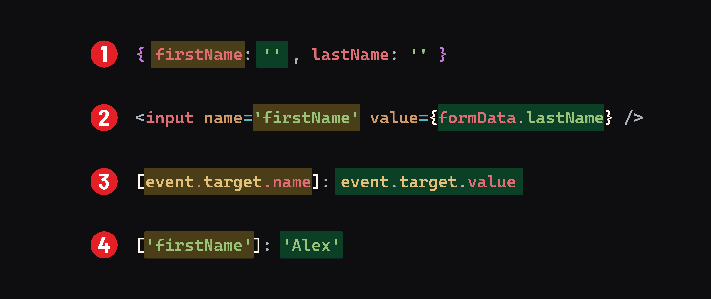

# 

**Learning objective:** By the end of this lesson, students will be able to utilize a single state object to manage form state.

## Time for a refactor

At this point, your App component should look like this:

```jsx
// src/App.jsx

import { useState } from 'react';

const App = () => {
  const [title, setTitle] = useState('The full name will appear here.');
  const [firstName, setFirstName] = useState('');
  const [lastName, setLastName] = useState('');

  const handleFirstNameChange = (event) => {
    setFirstName(event.target.value);
  };

  const handleLastNameChange = (event) => {
    setLastName(event.target.value);
  };

  return (
    <>
      <h2>{title}</h2>
      <form>
        <label htmlFor="firstName">First Name: </label>
        <input
          id="firstName"
          value={firstName}
          onChange={handleFirstNameChange}
        />
        <label htmlFor="lastName">Last Name: </label>
        <input id="lastName" value={lastName} onChange={handleLastNameChange} />
      </form>
    </>
  );
};

export default App;
```

You may have noticed that the code to manage this form state is repetitive. Imagine what the `App` component would look like if our form had even more inputs. With this method, each would need its own state and its own event handler.

To streamline our code, we can refactor how we manage our state. Instead of having separate state items for each input, like `firstName` and `lastName`, we can consolidate them into a single state object. This approach also allows us to create a more versatile function that can be used for multiple input fields.

First, let's change our state to the following:

```jsx
// src/App.jsx

  const [title, setTitle] = useState('The full name will appear here.');
  // Replace the firstName and lastName state variables with the following:
  const [formData, setFormData] = useState({
    firstName: '',
    lastName: '',
  });
```

Note that the event handler functions are causing errors now. That's okay, and we'll refactor them soon. There's nothing special about the `formData` name we've chosen for state; it's just the name of our state variable.

We now have an object that can hold state for both inputs. Update the `value` of each input to reflect our new state variable. We'll also add a `name` attribute to our inputs. We'll need this value in the next step:

```jsx
// src/App.jsx

      <form>
        <label htmlFor="firstName">First Name: </label>
        <input
          id="firstName"
          name="firstName"
          value={formData.firstName}
          onChange={handleFirstNameChange}
        />
        <label htmlFor="lastName">Last Name: </label>
        <input
          id="lastName"
          name="lastName"
          value={formData.lastName}
          onChange={handleLastNameChange}
        />
      </form>
```

With our form inputs refactored, let's also refactor our handler functions into a single function that can be passed to both inputs:

```jsx
// src/App.jsx

  // Remove this function:
  const handleFirstNameChange = (event) => {
    setFirstName(event.target.value);
  };

  // Remove this function:
  const handleLastNameChange = (event) => {
    setLastName(event.target.value);
  };

  // Replace them with the following:
  const handleChange = (event) => {
    setFormData({ ...formData, [event.target.name]: event.target.value });
  };
```

That might look strange. We'll talk about what's happening in this code in a moment, but first, let's get this to a state where it's working.

Let's change our inputs to use the new handler function:

```jsx
// src/App.jsx

      <form>
        <label htmlFor="firstName">First Name: </label>
        <input
          id="firstName"
          name="firstName"
          value={formData.firstName}
          onChange={handleChange}
        />
        <label htmlFor="lastName">Last Name: </label>
        <input
          id="lastName"
          name="lastName"
          value={formData.lastName}
          onChange={handleChange}
        />
      </form>
```

### Setting `formData`

tktk David


Back to the `handleChange()` function from earlier:

```jsx
// src/App.jsx

  const handleChange = (event) => {
    setFormData({ ...formData, [event.target.name]: event.target.value });
  };
```

**Note**: A couple of interesting things are happening here:

1. We use the spread operator to copy any values from the original state into the new object used to construct the new state. This way, when updating the `firstName` state, we don't lose the `lastName` state, and vice versa!
2. `event.target.name` takes the value of the name prop in our input form. We're able to access the key dynamically through the use of square bracket notation. If the user types into the `firstName` input, then the `name` of that input is used as the key and the `value` of that input is used as the value.

For a more visual example, typing the name "Sam" into the first name input would result in an event handler that does the following:

```jsx
// First letter typed ("S")
setFormData({ ...formData, firstName: 'S' })
// Second letter typed ("a")
setFormData({ ...formData, firstName: 'Sa' })
// Third letter typed ("m")
setFormData({ ...formData, firstName: 'Sam' })

// With our state looking like this afterward:
{
  firstName: 'Sam',
  lastName: ''
}
```

Note that because we are spreading all of our existing state into the new state object, we don't lose the `firstName` property's value even when we call the handler from our last name input:

```jsx
// First letter typed ("V")
setFormData({ ...formData, lastName: 'V' })
// Second letter typed("o")
setFormData({ ...formData, lastName: 'o' })

// Updated state:
{
  firstName: 'Sam',
  lastName: 'Vo'
}
```

As a result of this dynamic behavior, we can use this one function in both of our `onChange` handlers!

There's a lot going on in this event handler, and it might feel intimidating at first. However, there is good news - this code is highly repeatable.

> ♻️ Repeatable Pattern: For forms with text-based inputs, this exact `handleChange()` function can be used to manage form state - given that your state and elements are set up in a specific way.
>
> If your form state is set up like this:
>
> ```jsx
> const [formData, setFormData] = useState({
>   // a property should exist for every named input in the form
> });
> ```
>
> And if the inputs in your form have `name` props, then you can use this same `handleChange` function:
>
> ```jsx
> const handleChange = (event) => {
>   setFormData({ ...formData, [event.target.name]: event.target.value });
> };
> ```
>
> as the `onChange` handler for every text-based input in the form.
