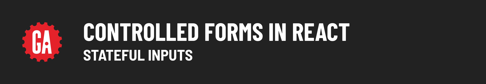
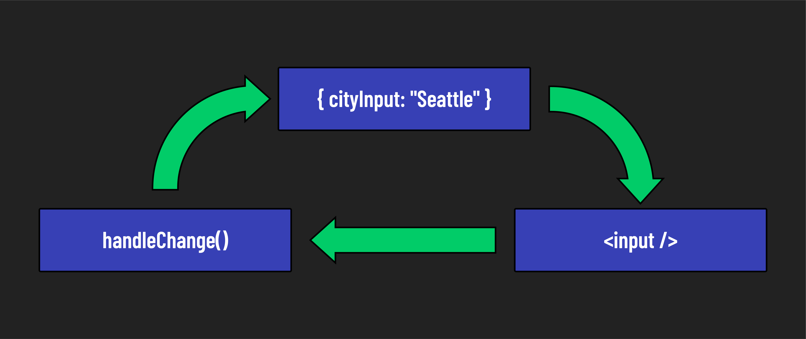

# 

**Learning objective:** BBy the end of this lesson, learners will be able to understand and implement a controlled form in React by correctly setting up state variables, handler functions, and controlled inputs.

Before diving into our first controlled form in React, let’s break down the key components and understand how they work together. In a controlled form, each input field is closely tied to the state of the component. 

In React, to manage an input field in a controlled form, you will typically need three things: 

- **A State Variable for the Input**: This holds the current value of the input.
- **A Handler Function**: This updates the state when the input changes.
- **A Controlled Input**: This input’s displayed value is directly controlled by the state variable.

Let's look at an example:

```jsx
import { useState } from 'react';

const App = () => {
  const [cityInput, setCityInput] = useState('');

  const handleChange = (event) => {
    setCityInput(event.target.value);
  };

  return (
    <>
      <input
        type="text"
        value={cityInput} // Bind state to value prop
        onChange={handleChange} // Update state on change
      />
    </>
  );
};
```

### 1. State Value

The `cityInput` state variable, initialized with an empty string, holds the current value of the text input. It is updated by `setCityInput`, which is called within the `handleChange` function every time there's a change in the input field.

### 2. Change Handler Function

The `handleChange` function is triggered each time a user types or deletes a character in the input. This function captures the new value from the input field using `event.target.value` and updates the `cityInput` state by calling `setCityInput`.

### 3. Input Field

The input field is a controlled component, with its `value` attribute bound to the `cityInput` state. This binding ensures that the displayed value in the input field always matches the current state, and it gets updated in real-time as the user types.

